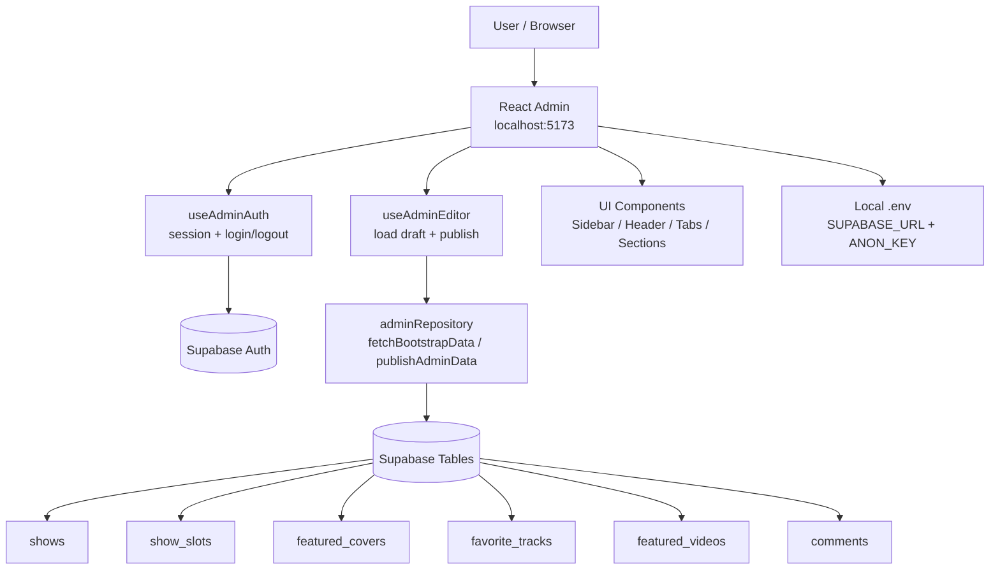

# Admin React

Ce dossier contient la version React-only de la page admin, connectee directement a Supabase (sans serveur PHP local).

## Lancer en local

Depuis la racine du repo, tu peux lancer sans te placer dans ce dossier:

```bash
npm run admin:install
npm run dev
```

Sinon en mode direct:

```bash
cd apps/admin
npm install
cp .env.example .env
# remplir VITE_SUPABASE_URL et VITE_SUPABASE_ANON_KEY
npm run dev
```

Connexion:
- utilise un compte Supabase Auth (email/password)
- ce compte doit avoir les permissions RLS pour modifier les tables admin
- le bucket Storage `admin-media` doit exister et autoriser les uploads pour les users `authenticated`

## Build production

```bash
npm run build
npm run preview
```

## Note

L'onglet `Scrolling banner` gere une liste ordonnee de messages francais et anglais.
Pour une base existante, executer `supabase/scrolling-banner-migration.sql` dans
le SQL Editor Supabase, puis recharger l'admin. Le schema initial inclut aussi cette table.
Les modifications restent en brouillon jusqu'a `Publish changes`. Les deux langues
sont obligatoires pour chaque message. Une liste vide masque le bandeau sur le site.
L'ordre et les traductions sont sauvegardes ensemble dans `public.scrolling_banner`.
La lecture est publique; l'ecriture exige `can_manage_content()` (admin/editor).
Recharger le site public pour voir les messages publies. Aucun changement Cloudflare
n'est necessaire. La migration peut etre relancee sans ecraser les messages modifies.

L'onglet `Team` gere jusqu'a 8 membres avec portrait, nom, role et texte FR/EN.
Sur desktop, jusqu'a 6 cartes partagent une ligne et les membres supplementaires
sont centres sur la suivante. Executer `supabase/team-members-migration.sql`
pour creer/remplir la table et reparer les URL locales des portraits existants.
La migration est relancable et ne remplace pas les portraits deja modifies.

Le bouton `Publish` envoie toutes les modifications directement a Supabase.
Ne jamais exposer une `service_role_key` dans ce frontend.

Les cartes `Vinyl covers` et `Mix sessions` se reorganisent depuis leur poignee
de deplacement, a la souris ou au tactile. Au clavier, placer le focus sur la
poignee, appuyer sur Espace, utiliser les fleches, puis Espace pour deposer
(Echap pour annuler). Les champs et les boutons d'upload restent independants
du glisser-deposer. Pendant un upload MP3, le tri des mix est desactive.
Les nouvelles cartes sont ajoutees en premiere position. L'ordre reste en
brouillon jusqu'a `Publish changes`, qui enregistre les positions `sort_order`.
Les mix restent limites a 8 cartes. Les uploads sont rattaches a l'identite
de la carte, meme si une nouvelle carte est ajoutee pendant le transfert.

Test de l'ordre des cartes : `npm --prefix apps/admin run test:ordering` depuis
la racine du repo.

Les uploads de covers, covers vinyl et MP3 passent par Supabase Storage dans le bucket `admin-media`, puis l'URL publique est sauvegardee dans la table concernnee.

