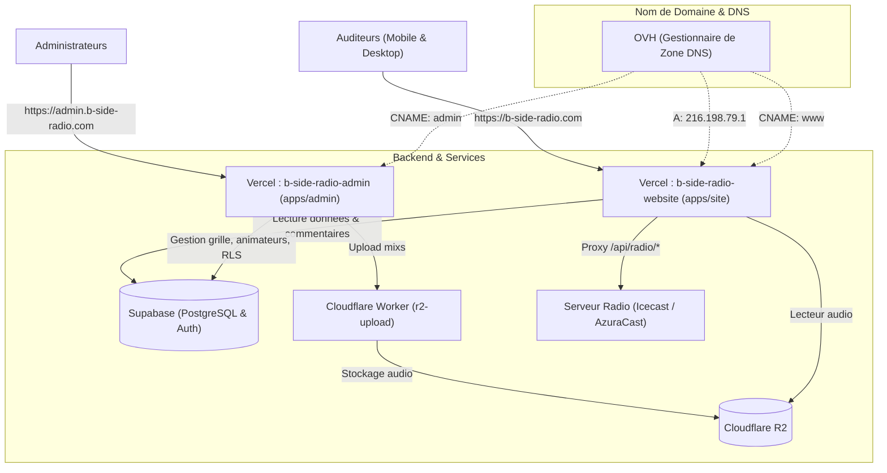

# Architecture & Guide de Déploiement - B-Side Radio

Ce document récapitule l'ensemble de l'infrastructure, la configuration réseau/DNS, les variables d'environnement et le workflow de déploiement de **B-Side Radio**.

---

## 1. Vue d'ensemble de l'Architecture



---

## 2. Les Domaines & Applications

| Application | Environnement | URL Publique | Projet Vercel | Dossier source |
| :--- | :--- | :--- | :--- | :--- |
| **Site Public** | **Production** | [`https://b-side-radio.com`](https://b-side-radio.com) (redirection 308 depuis `www`) | `b-side-radio-website` | `apps/site` |
| **Site Public** | **Preview (Test)** | `https://b-side-radio-website-git-preview-lauryfyots-projects.vercel.app` | `b-side-radio-website` | `apps/site` |
| **Back-office Admin** | **Production** | [`https://admin.b-side-radio.com`](https://admin.b-side-radio.com) *(sans `www`)* | `b-side-radio-admin` | `apps/admin` |

> [!NOTE]
> Le site public intègre une redirection automatique : taper `https://b-side-radio.com/admin` redirige directement l'utilisateur vers `https://admin.b-side-radio.com`.

---

## 3. Configuration DNS (Zone DNS chez OVH)

Le nom de domaine `b-side-radio.com` est enregistré chez **OVH**, mais pointe vers les serveurs de **Vercel** via les entrées suivantes :

| Sous-domaine | Type | Cible / Valeur | Utilité |
| :--- | :--- | :--- | :--- |
| *(vide)* (`@`) | **A** | `216.198.79.1` | Domaine racine `b-side-radio.com` vers Vercel |
| `www` | **CNAME** | `005d4892d3a8bf52.vercel-dns-017.com.` | Sous-domaine `www.b-side-radio.com` vers Vercel |
| `admin` | **CNAME** | `cname.vercel-dns.com.` | Sous-domaine `admin.b-side-radio.com` vers l'admin Vercel |

### Historique des nettoyages effectués chez OVH :
1. **Lignes IPv6 (AAAA) supprimées :** Les entrées `2001:41d0:301::21` pour `b-side-radio.com` et `www` ont été supprimées pour éviter que les visiteurs en IPv6 n'atterrissent sur l'ancien hébergement mutualisé d'OVH.
2. **Anciennes lignes A supprimées :** L'ancienne IP `188.165.53.185` (mutualisé OVH) a été remplacée par celle de Vercel.
3. **Messagerie :** Les entrées mails (`MX`, `SPF`, `DKIM`, `mail`, `smtp`, `imap`) ont été **conservées** pour ne pas couper les adresses e-mails OVH.

---

## 4. Variables d'Environnement (Vercel)

### Projet `b-side-radio-website` (Site public) :
* `VITE_SUPABASE_URL` : URL de l'instance Supabase.
* `VITE_SUPABASE_ANON_KEY` : Clé anonyme publique Supabase.
* `VITE_ADMIN_URL` : `https://admin.b-side-radio.com` (cible de redirection pour `/admin`).
* *(Le script Google Analytics 4 utilise la balise `G-3SNWYSPZ5Z`, activée uniquement lorsque le nom d'hôte est `b-side-radio.com`).*

### Projet `b-side-radio-admin` (Back-office) :
* `VITE_SUPABASE_URL` : URL de l'instance Supabase.
* `VITE_SUPABASE_ANON_KEY` : Clé anonyme publique Supabase.
* `VITE_R2_UPLOAD_URL` : URL du Cloudflare Worker pour uploader les fichiers audio des mixs.
* `VITE_SUPABASE_MEDIA_BUCKET` : Nom du bucket (par défaut : `admin-media`).

---

## 5. Workflow de Développement (Git & Vercel)

Le projet utilise un modèle à **deux branches principales** :

```text
[Branche dev / preview] ──(Push)──> Déploiement Preview automatique (URL stable)
                                            │
                                 (Pull Request validée)
                                            ▼
[Branche main]          ──(Merge)─> Déploiement Production (b-side-radio.com)
```

### Au quotidien :
1. **Travailler sur `preview` :**
   ```bash
   git checkout preview
   # ... modifications de code ...
   git add .
   git commit -m "feat: nouvelle fonctionnalite"
   git push origin preview
   ```
2. **Tester sans toucher à la production :**
   * Vercel compile et publie instantanément sur l'**URL permanente de test** :  
     `https://b-side-radio-website-git-preview-lauryfyots-projects.vercel.app`
   * *La protection "Vercel Authentication" est désactivée dans Settings > Deployment Protection, ce lien est donc consultable librement sur smartphone et partageable.*
3. **Mettre en ligne en production :**
   * Ouvrir une Pull Request sur GitHub : **`base: main` ⟵ `compare: preview`**.
   * Cliquer sur **Merge pull request** puis **Confirm merge**.
   * Vercel déploie automatiquement la version finale sur **`https://b-side-radio.com`** en ~30 secondes.

---

## 6. Bonnes Pratiques & Pièges Résolus

### A. Affichage de l'image Hero sur iOS (Safari & Chrome iPhone)
* **Problème :** Le moteur WebKit d'Apple gère mal la propriété `background-attachment: fixed` lorsqu'elle est combinée avec `border-radius`. L'image de fond ne s'affichait pas sur iPhone.
* **Solution :** L'effet `fixed` est restreint aux écrans d'ordinateur (`@media (min-width: 1024px) and (hover: hover)`). Sur mobile et tablette, l'image utilise un positionnement standard et s'affiche parfaitement.

### B. Fluidité du défilement tactile sur smartphone
* **Problème :** L'effet magnétique (`scroll-snap-type: y proximity`) gênait le défilement naturel au doigt sur mobile.
* **Solution :** `scroll-snap-type` est activé uniquement sur desktop (`min-width: 1024px`). Le défilement sur téléphone est désormais 100% libre et fluide.

### C. Syntaxe du sous-domaine admin
* **Piège classique :** `https://www.admin.b-side-radio.com` renvoie une erreur `NXDOMAIN`.
* **Règle :** Un sous-domaine ne prend jamais de `www.` devant. L'URL exacte est toujours :  
  👉 **`https://admin.b-side-radio.com`**.

### D. Désactivation de l'ancien déploiement SFTP vers OVH
* Dans `.github/workflows/deploy.yml`, le déclenchement automatique sur push de la branche `main` a été désactivé (commenté). Cela évite tout écrasement accidentel ou conflit avec l'ancien serveur mutualisé OVH.
