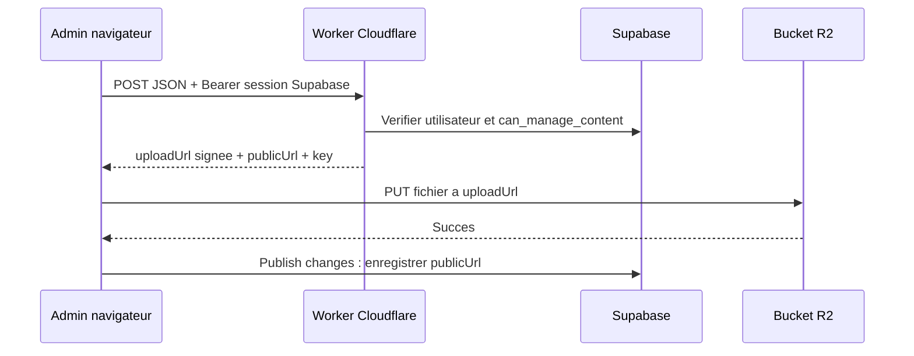

# Base de donnees et stockage

## Responsabilites

Supabase conserve les comptes et les donnees editoriales. R2 conserve les fichiers
importes. Les tables enregistrent des URL publiques, pas le contenu binaire des MP3
ou des photos. Les anciennes URL Supabase Storage et les images locales restent utilisables.

## Tables principales

| Table | Usage |
| --- | --- |
| `shows` | Emissions : nom, description, couverture |
| `show_slots` | Jours, horaires, priorite, lien vers une emission |
| `favorite_tracks` | Mixes : titre, DJ, MP3, couverture, recommandation, ordre |
| `featured_covers` | Carrousel vinyl : image, metadonnees, lien d'achat |
| `featured_videos` | Videos YouTube selectionnees |
| `comments` | Auteur, email optionnel, texte, statut, date et likes |
| `scrolling_banner` | Ligne singleton `id=1`, tableau JSON ordonne de messages `{fr,en}` |
| `team_members` | Nom, portrait, role/bio FR/EN, ordre ; maximum 8 membres |
| `profiles`, `roles`, `user_roles` | Comptes et attribution des roles |
| `site_settings` | Parametres generiques existants, distincts du bandeau |

Le schema de reference est [schema.sql](../supabase/schema.sql). Pour une base deja
en service, utiliser la migration pertinente, pas le schema complet sans revue.

## Migrations courantes

- [admin-content-migration.sql](../supabase/admin-content-migration.sql) : tables editoriales et moderation.
- [scrolling-banner-migration.sql](../supabase/scrolling-banner-migration.sql) : bandeau et messages initiaux.
- [team-members-migration.sql](../supabase/team-members-migration.sql) : equipe, portraits initiaux et plafond.
- [comments-email-migration.sql](../supabase/comments-email-migration.sql) et [comments-likes-migration.sql](../supabase/comments-likes-migration.sql) : email et likes.
- [import-legacy-comments.sql](../supabase/import-legacy-comments.sql) : remplacement de TOUS les commentaires par l'import historique ; ce n'est pas une migration de routine.

Executer dans Supabase SQL Editor avec un compte autorise. Verifier les prerequis
de chaque script (`can_manage_content`, fonctions de mise a jour, tables existantes).
Les migrations equipe/bandeau peuvent etre relancees, mais le seed equipe peut
recreer un membre historique absent : ne pas le relancer pour chaque changement de contenu.

## Auth et RLS

Les applications utilisent une cle publique Supabase. La securite des donnees
repose sur les politiques RLS, pas sur le fait de cacher l'URL de l'admin.
`can_manage_content()` permet les roles `super_admin`, `admin` et `editor`.

Le site filtre explicitement les commentaires sur `status = approved`, meme si
une session staff a le droit de lire les autres statuts. Les nouvelles soumissions
sont auto-approuvees par le trigger actuel. Les RPC de moderation/likes doivent
etre examinees avec leurs droits : plusieurs regles historiques sont permissives.
Ne pas assimiler une connexion Auth a une verification complete des permissions.

## Upload R2



L'URL signee expire apres 600 secondes. `aws4fetch` signe via l'API S3 compatible R2.
Le binding `BSIDE_MEDIA` sert a lister/supprimer, pas a generer une URL signee :
`createSignedUrl` n'existe pas sur un binding R2.

Dans l'admin, `VITE_R2_UPLOAD_URL` active R2. Si elle manque, le code utilise
Supabase Storage (`admin-media` par defaut). Si R2 est configure mais echoue,
l'erreur remonte : pas de repli silencieux.

Les mixes sont importes dans `tracks/`, les couvertures d'emissions dans `shows/`,
les vinyls et portraits d'equipe dans `covers/`.

## CORS : deux destinations

Le Worker autorise `POST, OPTIONS` et les headers `Content-Type, Authorization`.
Le bucket autorise le `PUT` direct, les lectures et le header `Content-Type`.
Le token Supabase n'est pas envoye au bucket.

Exemple de politique bucket, a adapter aux origines admin reellement utilisees :

```json
[
  {
    "AllowedOrigins": [
      "http://localhost:5173",
      "http://localhost:5174",
      "https://b-side-radio-admin.vercel.app",
      "https://admin.b-side-radio.com"
    ],
    "AllowedMethods": ["PUT", "GET", "HEAD"],
    "AllowedHeaders": ["Content-Type"],
    "ExposeHeaders": ["ETag"],
    "MaxAgeSeconds": 3600
  }
]
```

Ajouter aussi les origines necessaires dans `ALLOWED_ORIGINS` du Worker.
Attention : `https://admin.b-side-radio.com` n'est pas dans la liste du source
Worker inspecte ; il faut verifier et deployer ce reglage avant d'utiliser ce domaine.

## Nettoyage : ce qui est vraiment supprime

Apres publication, l'admin appelle `action: reconcile`. Le Worker lit les URL dans
`favorite_tracks`, `shows`, `featured_covers`, puis liste uniquement `tracks/`.
Il retire les candidats non references et les fichiers non references de plus de 24 h.
Une seconde lecture limite le risque d'effacer une reference ajoutee entre-temps,
mais DB et R2 ne forment pas une transaction atomique.

Le cron `0 3 * * *` nettoie les MP3 abandonnes : avec un passage quotidien, delai
approximatif de 24 a 48 h. Un brouillon vieux de plus de 24 h peut perdre son upload
non publie. Le nettoyage echoue sans supprimer si les lectures Supabase echouent.

**Limites actuelles :** pas de nettoyage automatique de `covers/`, `shows/`, des
photos equipe ou de Supabase Storage. Pas de migration automatique des vieux fichiers.
Pas de plafond dur de 10 Go dans le code ; les fichiers courants et brouillons
peuvent depasser l'offre gratuite R2. Les remplacements de photos peuvent s'accumuler.

## Secrets

Worker uniquement : `R2_ACCESS_KEY_ID`, `R2_SECRET_ACCESS_KEY`,
`SUPABASE_SERVICE_ROLE_KEY`. Variables de configuration Worker : `R2_ACCOUNT_ID`,
`R2_BUCKET_NAME`, `PUBLIC_BASE_URL`, `SUPABASE_URL`.

Jamais de `service_role` ou de cle R2 dans `VITE_*` : ces variables sont visibles
dans le JavaScript livre au navigateur. Revoquer un secret divulgue ; l'effacer
du dernier commit ne l'efface pas de l'historique.