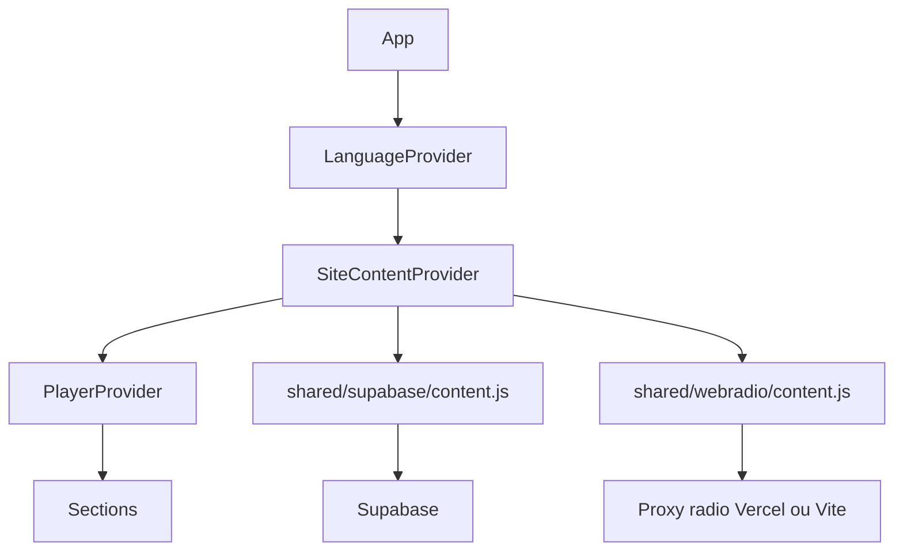

# Architecture React

## Organisation

```text
apps/site/       React 19 + TypeScript + Vite : site public
apps/admin/      React 18 + JavaScript + Vite : back-office
shared/supabase/ Client public, lectures, commentaires, mapping des donnees
shared/webradio/ Fournisseurs radio et normalisation des metadonnees
workers/         Worker Cloudflare : signature R2 et nettoyage
supabase/        Schema, migrations et imports SQL
assets/          Images et exports historiques partages
```

Les deux applications ont leurs propres dependances, configuration Vite, HTML et
variables de build. Un build admin n'est pas un build site.

## Site public

Point d'entree : [main.tsx](../apps/site/src/main.tsx), puis [App.tsx](../apps/site/src/App.tsx).
La home assemble Nav, Hero, OnAir, About, Vinyls, Programme, Team, MixSessions,
Videos, Comments, Footer et PlayerBar. Replays est actuellement commente dans la home.
Le chemin `/admin` affiche une redirection, pas le back-office dans le meme bundle.



- [siteContent.ts](../apps/site/src/lib/siteContent.ts) charge le contenu une fois et expose `useSiteContent`.
- [bside-data.ts](../apps/site/src/lib/bside-data.ts) contient les donnees/images de repli.
- [i18n.tsx](../apps/site/src/lib/i18n.tsx) expose langue et traductions statiques.
- [player-context.tsx](../apps/site/src/components/player/player-context.tsx) controle l'audio persistant.
- [section-manager.tsx](../apps/site/src/components/bside/section-manager.tsx) fournit le cadre commun des sections.
- [styles.css](../apps/site/src/styles.css) porte le theme Tailwind v4 et les styles specifiques.

Equipe : `null` signifie table indisponible et active le fallback ; `[]` signifie
une equipe volontairement vide. Meme distinction pour le bandeau. Le contexte
radio se rafraichit toutes les 20 secondes, pas tous les contenus editoriaux.

## Admin

[App.jsx](../apps/admin/src/App.jsx) assemble l'authentification et l'editeur.
[useAdminAuth.js](../apps/admin/src/hooks/useAdminAuth.js) restaure la session et gere login/logout.
[useAdminEditor.js](../apps/admin/src/hooks/useAdminEditor.js) conserve les brouillons,
les identifiants supprimes, le snapshot publie et l'action Publish.
[adminRepository.js](../apps/admin/src/lib/adminRepository.js) centralise Auth,
lectures DB, upload et ecritures de publication.

[AdminContent.jsx](../apps/admin/src/components/AdminContent.jsx) branche les
sections ; [adminUi.js](../apps/admin/src/constants/adminUi.js) definit les onglets ;
[AdminTabs.jsx](../apps/admin/src/components/AdminTabs.jsx) associe leurs icones.

Un upload est immediat, mais son URL reste dans le brouillon jusqu'a publication.
Publish valide les champs, ecrit les tables, recharge la DB, puis demande le nettoyage R2.
Les ecritures multi-tables ne sont pas transactionnelles : une erreur peut arriver
apres certaines ecritures. Le message de nettoyage distingue un contenu deja publie.

## Ajouter une nouvelle rubrique

1. Definir la table, les droits RLS et la migration.
2. Ajouter lecture/ecriture dans `adminRepository`, etat/snapshot/validation dans `useAdminEditor`.
3. Ajouter onglet, icone et composant d'edition dans l'admin.
4. Ajouter lecture/mapping partages et declaration dans `shared/supabase/content.d.ts`.
5. Exposer la rubrique dans `siteContent`, puis la rendre depuis un composant site.
6. Tester absence de migration, liste vide, edition, publication et permissions.

Pour les listes mutables, employer un identifiant stable pour l'upload : ne pas
appliquer son resultat a un index qui a pu changer. Les membres equipe utilisent
un ID sauvegarde ou un UUID de brouillon, avec IDs DOM uniques pour les champs photo.